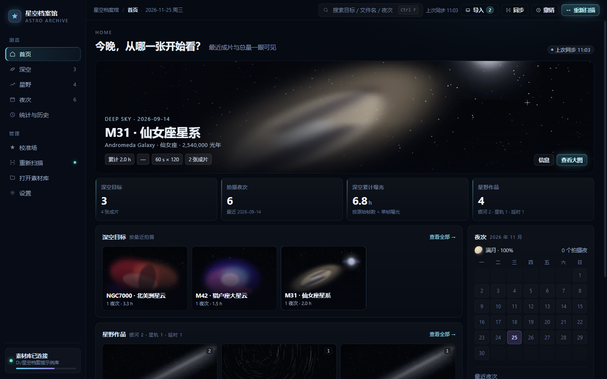
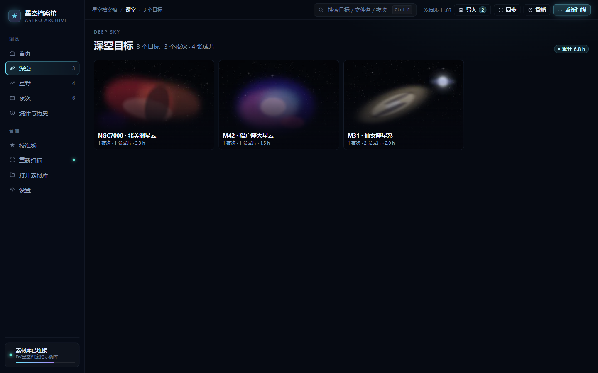
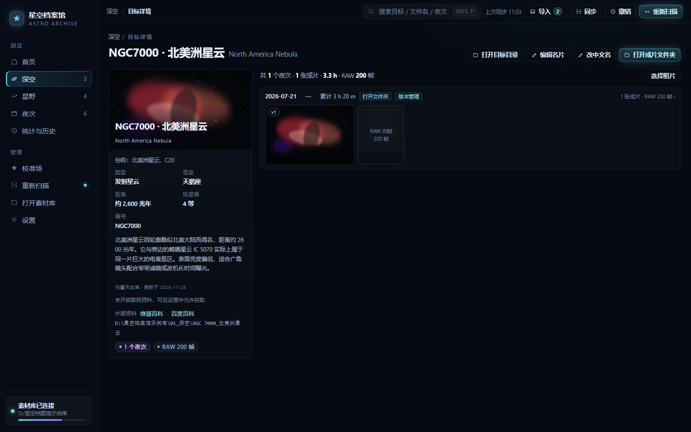
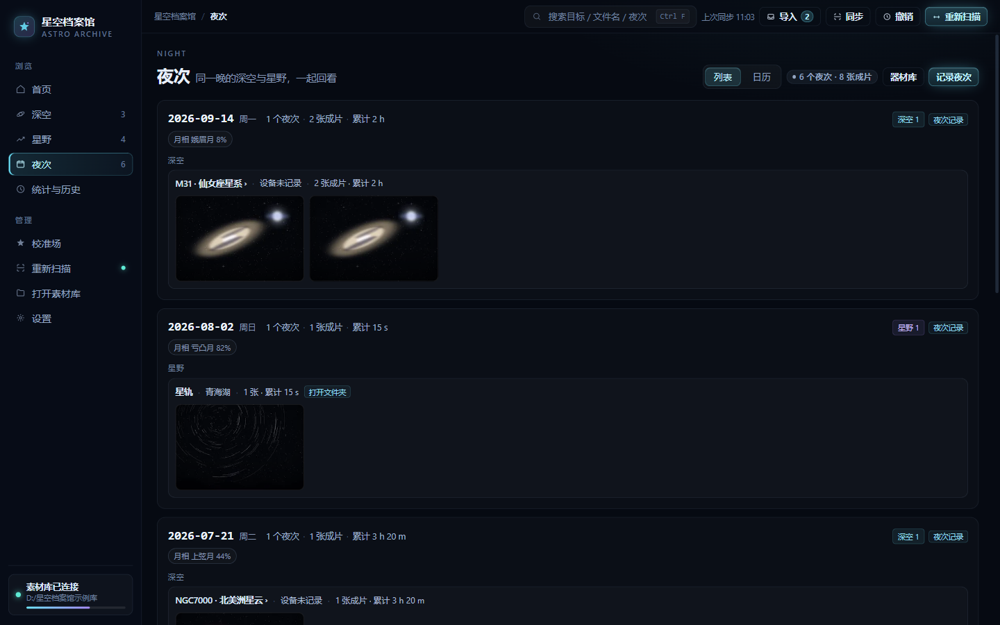
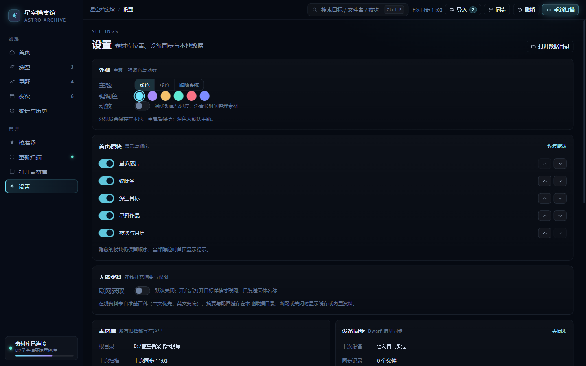

# 星空档案馆（Astro Archive）

本地优先的天文摄影素材归档管理工具。把深空、星野与延时素材按「目标 / 夜次 / 成片」整理成可检索的档案，全程离线，素材不出本机。

## 主要功能

- **建库向导**：选择或新建素材库目录，自动创建标准目录结构并校验可写性。
- **扫描与缩略图**：扫描深空目标、星野夜次、成片与视频，生成多尺寸缩略图；支持增量扫描。
- **Dwarf 会话识别**：识别设备会话目录，解析 `shotsInfo.json` 与拍摄水印，自动归纳目标、曝光、器材与夜次。
- **收件箱导入**：拖拽或选择文件夹导入，先预览归档结果，可选择「暂不整理」稍后处理。
- **成片版本**：同一目标同一天按拍摄顺序登记版本，可标记最终版并关联来源夜次。
- **检索与批量编辑**：按目标、器材、版本、标签、日期等条件检索，支持批量修改评分与标记。
- **夜次记录**：夜次卡片、月历视图、天气与后期备注、器材关联。
- **校准场管理**：bias / dark / flat 分类归档与统计。
- **可选的在线天体名片**：默认关闭；开启后只发送天体名称到维基百科查询简介。
- **外观设置**：深/浅/跟随系统主题、强调色、减少动效、首页模块显隐与排序。
- **数据安全**：索引数据库每天自动备份（保留最近 7 份），设置页可一键恢复；运行日志落在本地 `logs` 目录，便于排查问题。

## 界面预览

截图使用内置示例素材库拍摄的合成图片，不包含任何真实素材与本机路径。

| 首页 | 深空 |
| --- | --- |
|  |  |

| 目标详情 | 夜次 |
| --- | --- |
|  |  |

| 设置与外观 |
| --- |
|  |

## 系统要求

- Windows 10 / 11 x64
- Node.js **≥ 22.5**（使用内置 `node:sqlite`，无需额外数据库）
- 开发与打包需要 npm

## 快速开始

```powershell
cd app
npm install
npm run dev
```

首次启动会弹出建库向导。如果只是想预览界面，可先选择一个空文件夹作为素材库。

## 开发命令

在 `app` 目录下执行：

```powershell
npm run typecheck    # TypeScript 类型检查
npm test             # 运行全部测试（真机相关用例会自动跳过）
npm run build        # 构建主进程与渲染进程
npm run pack         # 打包 Windows x64 便携版与 NSIS 安装版，输出到 app/release
```

## 环境变量

| 变量 | 用途 |
| --- | --- |
| `ASTRO_DATA_DIR` | 覆盖应用数据目录，默认 `%APPDATA%\AstroArchive` |
| `ASTRO_REAL_DEVICE` | 真机素材根目录，设置后才运行 `real-copy` / `real-mosaic` 测试 |
| `ASTRO_REAL_SAMPLE` | 水印识别测试用的真实样本路径，未设置则跳过 |
| `ASTRO_PROBE_LIBRARY` | 调试脚本 `scripts/probe.ts` 扫描的素材库目录 |

## 数据与隐私

- 素材文件只读扫描，软件不会修改或上传原始文件。
- 索引数据库、缩略图与缓存均位于本机数据目录（默认 `%APPDATA%\AstroArchive`）。
- 不包含账号体系，也没有云端同步。
- 在线天体名片默认关闭，开启后仅发送天体名称到维基百科。

## 目录结构

```text
.
├─ app/                  Electron 应用
│  ├─ src/main/          主进程：数据库、扫描、导入、同步、OCR 等
│  ├─ src/renderer/      React 界面
│  ├─ tests/             测试用例（node:test）
│  ├─ scripts/           开发、构建、打包与调试脚本
│  └─ assets/tessdata/   Tesseract 中文语言数据
├─ docs/design/          早期 PRD、开发基线、线框图与视觉稿
├─ LICENSE
└─ THIRD_PARTY_NOTICES.md
```

## 已知限制

- 提供 Windows x64 便携版与 NSIS 安装版：安装版按当前用户安装、可选安装目录，并创建桌面与开始菜单快捷方式。
- 两种产物均未做代码签名，首次运行可能触发 SmartScreen 提示。
- 暂不支持自动更新。
- 只面向本地单机使用，不含多设备协同。

## 许可

本项目以 [MIT](LICENSE) 许可发布。第三方组件与语言数据的许可见 [THIRD_PARTY_NOTICES.md](THIRD_PARTY_NOTICES.md)。
